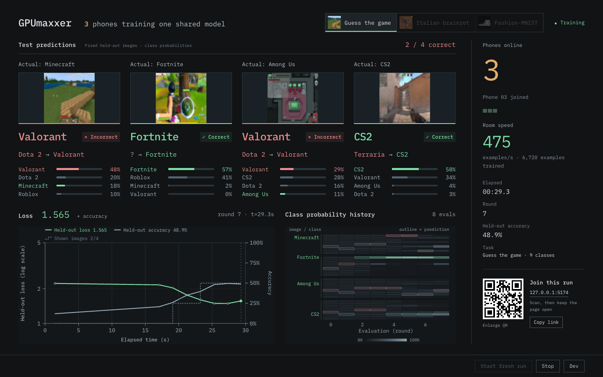
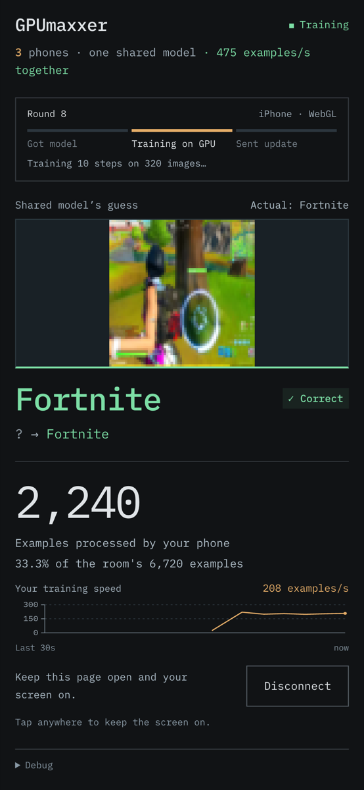

# GPUmaxxer

### Your phone is a GPU. A room full of them is a datacenter.

GPUmaxxer turns every phone in a room into one training cluster. Scan a QR code and your phone's GPU starts training a shared AI model with everyone else's, live, in the browser. No app, no install, no account.

**Big screen:** [gpu.chantalz.workers.dev/?role=laptop](https://gpu.chantalz.workers.dev/?role=laptop) · **Phones:** scan the QR or open [gpu.chantalz.workers.dev](https://gpu.chantalz.workers.dev)



## Why

AI runs on GPUs. Training a model is millions of independent multiplications, and a GPU runs thousands of them in parallel where a CPU does a handful. That's why GPUs are the most fought-over hardware in tech, and why most people will never train a model themselves.

But almost everyone already carries a GPU in their pocket, and it sits idle most of the day. GPUmaxxer puts those GPUs to work together, and makes distributed training, the thing every frontier lab runs on, something you can watch happen on a projector.

## What happens when you scan

1. Your phone loads the page and gets its own slice of the training data (~3 MB).
2. Every round, it downloads the current shared model, trains it for 10 steps on its slice using its GPU (WebGPU), and sends back how its weights changed.
3. A relay sums every phone's update. The laptop merges the total into the shared model and sends it back out. About 3 rounds a second on an iPhone.
4. The big screen shows it live: held-out test images flipping from `?` to the right answer, loss falling and accuracy rising, a square per phone that flashes when its update lands, and the room's combined examples per second.



Your phone shows its side of it: the current round, how many images it trained on and how fast, and its share of the room's work.

## More phones = a better model, not just a faster one

Each phone trains on a **different slice** of the data. One phone only ever sees its own 999 images and plateaus in the 70s. Three or more phones see more of the dataset between them and pass **90%** in a 50 second run (simulated on the real data). The size of the crowd decides how good the model gets, and every run is a fixed 50 seconds so you can see it.

<br clear="right" />

## How it works

```
phones (WebGPU)  <-->  relay (Cloudflare Durable Object)  <-->  laptop (big screen)
 10 local Adam          fans the model out, sums updates       Nesterov outer step,
 steps per round        weighted by examples, one message      evaluates on held-out
                        back per round                         data, draws everything
```

**Training: local SGD with a DiLoCo-style outer optimizer.** Each phone runs 10 Adam steps (lr 0.01, 32 images per step) on its own copy of the model and returns the weight delta. The laptop treats the example-weighted average delta as a gradient and applies Nesterov momentum SGD (lr 0.5, momentum 0.9). Plain averaging (FedAvg) is the special case with lr 1 and no momentum. In simulation, the momentum step reached the same accuracy about **2× faster**, and 10 local steps beat 5 and 20.

**The model** is a small CNN: three conv layers (8/16/32 filters), pooling, one dense layer. ~6,300 weights, small enough to sync every round from a phone browser.

**Networking.** Everything goes over WebSockets through one relay, a Cloudflare Durable Object that holds every connection. The laptop sends the weights once, the relay fans them out with each phone's batch assignment, sums the updates as they arrive, and sends back a single result. The laptop's cost stays flat no matter how many phones join. Weights travel as packed float32: **124 KB as JSON → 32 KB**.

**Honest evaluation.** Accuracy is measured every round on 830 held-out images from **videos the model never trained on**. Gameplay frames are near-duplicates of their neighbors, so a random split would leak. The 4 images on screen are separate held-out images. Cards show `?` until the top guess is at least 1.5× chance, because an untrained model's top pick is just noise.

## Built for a real room

- **Stragglers don't stall the room.** Each round has a deadline. A phone that misses it sits out 1, 2, 4… rounds and rejoins as soon as it delivers.
- **Phones reconnect by themselves** after a wifi blip or a locked screen, and rejoin from the next round. Join or leave any time.
- **The laptop can recover.** Reloading the big screen takes over cleanly and the phones stay connected.
- **Clear fallbacks.** Phones without WebGPU, or people who scanned inside Instagram or Snapchat, are told exactly which browser to open. The big screen counts how many can't join.
- **Scales.** Up to 500 phones per round (beyond that they take turns). Load-tested with **400 simulated phones at ~0.9 s per round**.

## Numbers

| | |
|---|---|
| iPhone, WebGPU | ~22 ms per step, ~0.3 s per round |
| iPhone + Mac vs iPhone alone | 1.6× faster to 78% (Fashion-MNIST, 3 runs each) |
| 400 simulated phones | ~0.9 s per round, laptop ~160–220 ms of it |
| Guess the game, simulated, 50 s | 1 phone ~77%, 3+ phones 92–94% |

## Tasks

- **Guess the game:** 9 games (Fortnite, Minecraft, Among Us, Roblox, Terraria, Valorant, CS2, Dota 2, League) from 32×32 gameplay screenshots. Three public datasets combined, tested on unseen videos.
- **Italian brainrot:** 5 characters. Small and noisy, deduplicated from 1,388 files to 818 unique images.
- **Fashion-MNIST:** the classic.

## How it was built

Every major decision came from a measurement:

- A **PyTorch simulator** (`ml/sim.py`) chose the merging method, optimizer and local step count before any phone code existed.
- The first iPhone test **froze after 2 steps on WebGL**, so training moved to WebGPU.
- When more phones made the laptop the bottleneck, **summing moved into the relay**.
- Saved runs showed 80% arrived in 7–17 seconds, too fast to watch. Simulating longer runs found the more-phones-means-smarter result and set the **fixed 50 s run**.
- A **dev dashboard** shows every phone, its GPU memory, why it dropped, and each round split into compute, network and laptop time. Every run is saved to `runs/`.
- **Tests:** unit tests, plus headless-Chrome end-to-end runs that simulate GPU resets, dropped connections, laptop takeovers and phones without WebGPU.

## Run it

Needs Node 22.

```bash
npm ci
npm start                  # http://127.0.0.1:4173
```

Open `http://127.0.0.1:4173/?role=laptop` for the big screen and `http://127.0.0.1:4173/` in a few tabs as phones. Pick a task at the top, then click **Start fresh run**. **Dev** opens settings and per-phone details.

```bash
npm test                   # unit tests
npm run test:browser       # end-to-end runs in headless Chrome
npm run deploy             # publish to Cloudflare (npx wrangler login first)
npm run fake-phones -- 400 wss://gpu.chantalz.workers.dev/swarm   # load test
```

Python in `ml/` (`uv run ml/<script>.py`): `prepare_games.py` and `prepare_brainrot.py` build the datasets, `export_images.py` writes the files phones download, `bench_images.py` checks a task is learnable, `sim.py` simulates phones training together.

## Stack

TensorFlow.js on WebGPU · plain JS + Vite · Cloudflare Workers + Durable Objects · WebSockets · PyTorch for data prep and simulation

## Credits

Game screenshots: [Gameplay Images](https://huggingface.co/datasets/Bingsu/Gameplay_Images), [Gamed](https://huggingface.co/datasets/ybashir/gamed-game-classification-dataset), [ViT Video Game Classification](https://zenodo.org/records/15574186) (CC BY 4.0). Brainrot: [Italian Brainrot Images](https://www.kaggle.com/datasets/bubblepw/italian-brainrot-images). Fashion-MNIST by Zalando Research (MIT). Details in `public/data/`.
